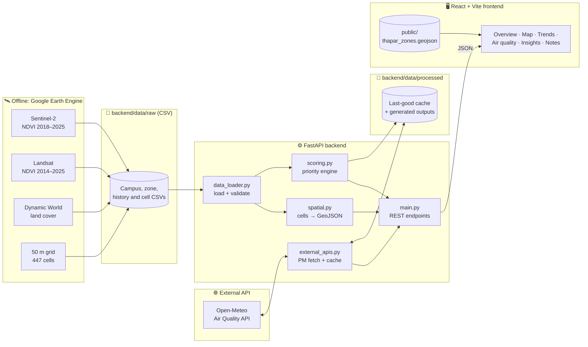
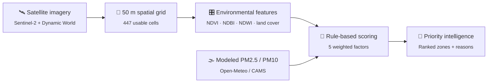
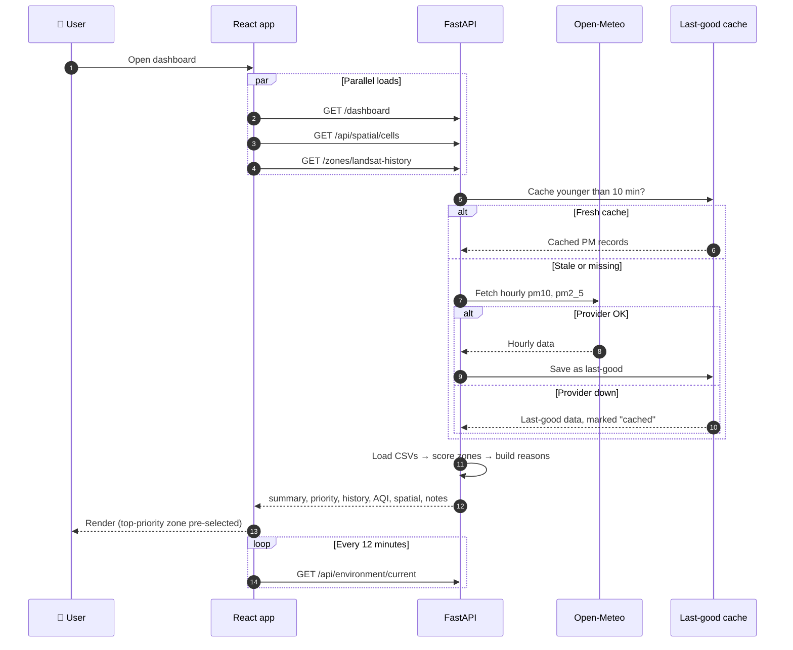
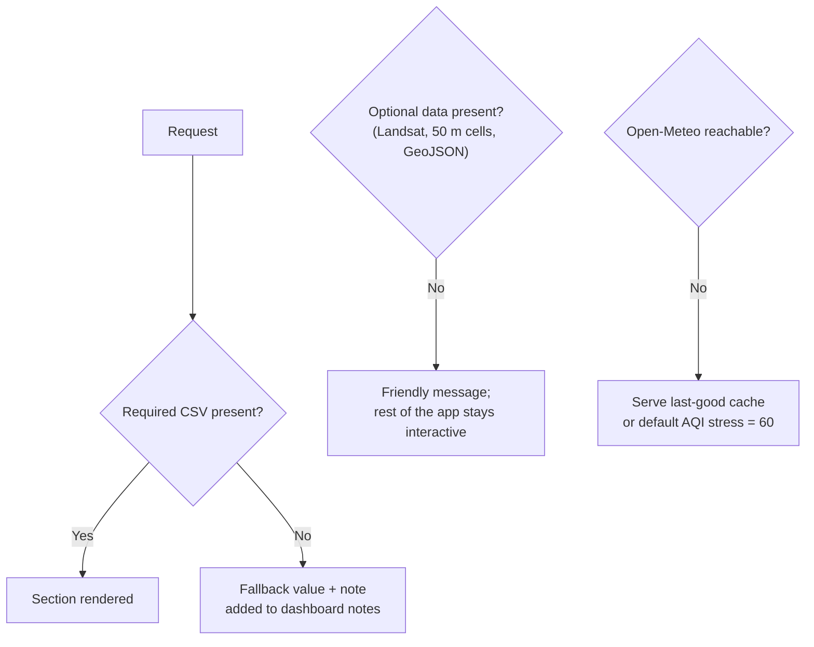
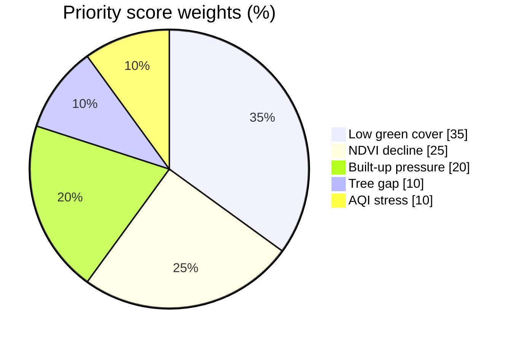

<!-- ============================== HEADER ============================== -->
<p align="center">
  
</p>

<p align="center">
  <b>Satellite vegetation, land-cover pressure and air-quality context, turned into an <i>explainable</i> ranking of which campus zones need attention first.</b><br/>
  Pilot site: Thapar Institute of Engineering &amp; Technology, Patiala, Punjab, India
</p>

<p align="center">
  
  
  
  
</p>

<p align="center">
  <a href="#-features">Features</a> •
  <a href="#-tech-stack">Tech Stack</a> •
  <a href="#-architecture">Architecture</a> •
  <a href="#-how-it-works">How It Works</a> •
  <a href="#-priority-scoring">Scoring</a> •
  <a href="#-getting-started">Getting Started</a> •
  <a href="#-api-reference">API</a> •
  <a href="#-limitations">Limitations</a> •
  <a href="#-roadmap">Roadmap</a>
</p>

---

## 🌱 Overview

GreenPulse AI answers five practical questions for campus planners:

| # | Question | Signal used |
|:-:|---|---|
| 1 | Which zones have weaker vegetation? | Sentinel-2 NDVI, green-cover % |
| 2 | Which zones are losing vegetation over time? | NDVI change 2018 → 2025 |
| 3 | Which zones are under built-up pressure? | Dynamic World land cover |
| 4 | What is the recent PM2.5 / PM10 stress near campus? | Open-Meteo / CAMS modeled air quality |
| 5 | **Which zones should be reviewed first, and why?** | Weighted, explainable priority score |

The campus was outlined in Google Earth Engine and split into **5 analysis zones** and **447 usable 50 m × 50 m cells**. Every score shows its contributing factors and a plain-English reason, so no number is a black box.

> [!NOTE]
> This is an honest MVP: **no ML model, local sensor, drone, or plant-species module is implemented yet.** Those are listed under [Roadmap](#-roadmap).

---

## ✨ Features

<table>
<tr>
<td width="50%" valign="top">

**🗺️ Spatial intelligence**
- Interactive Leaflet map of 5 zones + 447 cells (50 m)
- 9 switchable layers: priority, NDVI, green cover, built-up, tree cover, NDBI, NDWI, plantable potential, NDVI decline
- Zone and cell detail panels with transparent score contributors
- Deep-link a layer with `?layer=ndvi`

</td>
<td width="50%" valign="top">

**📈 Vegetation trends**
- Sentinel-2 zone and cell NDVI trends, 2018–2025
- Separate Landsat long-term context, 2014–2025
- Sources are shown as separate series, never mixed

</td>
</tr>
<tr>
<td width="50%" valign="top">

**🌫️ Air-quality context**
- Live modeled PM2.5 / PM10 with 24H, 48H and 7D views
- 10-minute backend cache, 12-minute frontend auto-refresh
- Last-good cache served if the provider is down, clearly labelled as cached

</td>
<td width="50%" valign="top">

**🧠 Explainable priority**
- Weighted 5-factor score per zone, classed Low → Urgent
- Auto-generated reason for every zone
- Deterministic insights plus a sources and limitations view
- Missing optional files degrade gracefully and never crash the app

</td>
</tr>
</table>

---

## 🛠️ Tech Stack

<p align="center">
  <a href="https://skillicons.dev">
    
  </a>
</p>

<p align="center">
  
  
  
  
  
  
  <br/>
  
  
  
  
  
  
  <br/>
  
  
  
  
  
  
</p>

| Layer | Technology | Role |
|---|---|---|
| **Frontend** | React 18, Vite 6, plain CSS | Single-page product interface |
| **Maps** | Leaflet, React Leaflet | Zone and 50 m cell layers |
| **Charts** | Recharts | NDVI trends, PM2.5 / PM10 history |
| **Motion & icons** | Framer Motion, Lucide | Micro-interactions (honours reduced-motion) |
| **Backend** | FastAPI, Uvicorn | REST API with auto-generated OpenAPI docs |
| **Processing** | pandas, NumPy | CSV loading, joins, scoring |
| **Earth observation** | Google Earth Engine (Sentinel-2, Landsat, Dynamic World) | NDVI, NDBI, NDWI, land-cover exports |
| **Air quality** | Open-Meteo / CAMS API, OpenAQ export | Modeled PM context, station reference |

---

## 🏗️ Architecture



### Project structure

```text
greenpulse_ai/
├── backend/
│   ├── app/
│   │   ├── main.py            # FastAPI app and all endpoints
│   │   ├── config.py          # Paths, coordinates, file names, constants
│   │   ├── data_loader.py     # CSV loading, required/optional handling
│   │   ├── scoring.py         # Environmental priority engine
│   │   ├── spatial.py         # 50 m cell GeoJSON and cell history
│   │   ├── external_apis.py   # Open-Meteo client, PM stress, caching
│   │   └── schemas.py         # Pydantic response models
│   ├── data/
│   │   ├── raw/               # Earth Engine and OpenAQ CSV exports
│   │   └── processed/         # Runtime outputs (git-ignored)
│   └── requirements.txt
├── frontend/
│   ├── public/thapar_zones.geojson
│   ├── src/
│   │   ├── App.jsx            # Data loading, selection state, auto-refresh
│   │   ├── api.js             # API client (VITE_API_BASE_URL)
│   │   └── components/
│   │       ├── overview/      # Hero, metric grid, pipeline band
│   │       ├── map/           # Spatial intelligence, layers, legend
│   │       ├── trends/        # Sentinel-2 and Landsat NDVI trends
│   │       ├── air-quality/   # PM2.5 / PM10 views
│   │       ├── insights/      # Deterministic insights
│   │       ├── layout/        # App shell, nav, status indicator
│   │       └── common/        # Badge, MetricCard, Skeleton, ...
│   └── package.json
├── docs/                      # Project context and source notes
└── README.md
```

---

## 🔄 How It Works

### Intelligence pipeline



### Request flow: loading the dashboard



### Graceful degradation



---

## 🧮 Priority Scoring

Each zone gets a transparent score from **0 to 100**. All inputs are clipped to the 0–100 range.

| Factor | Formula | Weight |
|---|---|:-:|
| 🌿 Low Green Cover | `100 − green_cover_percent` | **35%** |
| 📉 NDVI Decline | `min(\|ΔNDVI\| / 0.10 × 100, 100)` if ΔNDVI < 0, else `0` | **25%** |
| 🏢 Built-up Pressure | `built_up_percent` | **20%** |
| 🌳 Tree Gap | `100 − tree_percent` | **10%** |
| 🌫️ AQI Stress | `0.6 × pm25_score + 0.4 × pm10_score` | **10%** |



<details>
<summary><b>Formula details</b></summary>

```text
ΔNDVI       = latest_year_mean_ndvi − first_year_mean_ndvi      (Sentinel-2, e.g. 2025 − 2018)

pm25_score  = min((mean of last 24 h PM2.5 / 60)  × 100, 100)
pm10_score  = min((mean of last 24 h PM10  / 100) × 100, 100)
AQI Stress  = 0.6 × pm25_score + 0.4 × pm10_score              (defaults to 60 if no data)

Priority    = 0.35 × LowGreenCover
            + 0.25 × NDVIDecline
            + 0.20 × BuiltUpPressure
            + 0.10 × TreeGap
            + 0.10 × AQIStress
```

</details>

### Priority classes

| Class | Score | Map colour |
|---|:-:|:-:|
| 🟢 **Low** | 0 – 30 | Green |
| 🟡 **Moderate** | 31 – 50 | Yellow |
| 🟠 **High** | 51 – 70 | Orange |
| 🔴 **Urgent** | 71 – 100 | Red |

### Explainability

Each zone gets a generated reason built from these triggers:

| Trigger | Reason phrase |
|---|---|
| `green_cover_percent < 60` | low green-cover percentage |
| `ndvi_change < −0.05` | declining NDVI trend |
| `built_up_percent > 70` | high built-up pressure |
| `aqi_stress_score > 60` | elevated PM/AQI stress |

> *"Priority is driven by low green-cover percentage, declining NDVI trend, and high built-up pressure."*

---

## 🚀 Getting Started

### Prerequisites

- **Python** 3.10+
- **Node.js** 18+ and npm

### 1. Clone

```powershell
git clone https://github.com/Gupta2708/GreenPulse-AI.git
cd GreenPulse-AI
```

### 2. Start the backend

```powershell
cd backend
python -m venv venv
venv\Scripts\activate          # macOS/Linux: source venv/bin/activate
pip install -r requirements.txt
uvicorn app.main:app --reload --host 127.0.0.1 --port 8000
```

### 3. Start the frontend (new terminal)

```powershell
cd frontend
npm install
npm run dev -- --host 127.0.0.1 --port 5173
```

### 4. Open

| Service | URL |
|---|---|
| 🖥️ Dashboard | http://127.0.0.1:5173 |
| ⚙️ API | http://127.0.0.1:8000 |
| 📚 Interactive API docs (Swagger) | http://127.0.0.1:8000/docs |

> [!TIP]
> If the API runs somewhere other than `http://localhost:8000`, set `VITE_API_BASE_URL` before starting the frontend.

---

## 📂 Datasets

Place the CSV exports in `backend/data/raw/` and the zone map in `frontend/public/`.

| File | Source | Status |
|---|---|:-:|
| `thapar_campus_summary.csv` | Earth Engine | ✅ Required |
| `thapar_zone_ndvi_green_cover.csv` | Sentinel-2 | ✅ Required |
| `thapar_zone_land_cover.csv` | Dynamic World | ✅ Required |
| `thapar_historical_zone_ndvi_2018_2025.csv` | Sentinel-2 | ✅ Required |
| `thapar_50m_master_current_2025.csv` | Earth Engine, 50 m grid | ➕ Optional |
| `thapar_50m_historical_ndvi_2018_2025.csv` | Sentinel-2, 50 m grid | ➕ Optional |
| `thapar_landsat_historical_zone_ndvi_2014_2025.csv` | Landsat | ➕ Optional |
| `openaq_location_5544_measurements.csv` | OpenAQ | ➕ Optional |
| `frontend/public/thapar_zones.geojson` | Earth Engine | ➕ Optional (map shows a fallback if missing) |

<details>
<summary><b>Generated outputs</b> (written to <code>backend/data/processed/</code>, git-ignored)</summary>

| File | Contents |
|---|---|
| `zone_environmental_priority.csv` | Full scored priority table |
| `open_meteo_recent_hourly.csv` | Hourly PM2.5 / PM10 records |
| `open_meteo_last_good.json` | Last successful provider response |
| `dashboard_summary.json` | Last `/dashboard` payload |

</details>

---

## 📡 API Reference

<details open>
<summary><b>Core</b></summary>

| Method | Endpoint | Description |
|:-:|---|---|
| `GET` | `/` | Service status |
| `GET` | `/health` | Health check |
| `GET` | `/summary` | Campus-level summary |
| `GET` | `/zones/ndvi` | Current zone NDVI and green cover |
| `GET` | `/zones/land-cover` | Zone land-cover percentages |
| `GET` | `/zones/historical-ndvi` | Sentinel-2 zone history, 2018–2025 |
| `GET` | `/zones/landsat-history` | Landsat zone history, 2014–2025 (optional) |
| `GET` | `/priority` | Ranked environmental priority table |
| `GET` | `/dashboard` | Everything the UI needs, in one call |

</details>

<details>
<summary><b>Spatial intelligence</b></summary>

| Method | Endpoint | Description |
|:-:|---|---|
| `GET` | `/api/spatial/cells` | 50 m cells as a GeoJSON FeatureCollection |
| `GET` | `/api/spatial/cells/history?cell_id=C_12613%2C67168` | NDVI history for one cell |
| `GET` | `/api/spatial/cells/history?zone_id=Z01` | NDVI history for all cells in a zone |

</details>

<details>
<summary><b>Live modeled environment</b></summary>

| Method | Endpoint | Description |
|:-:|---|---|
| `GET` | `/api/environment/current` | Current PM values, 24 h averages, stress score |
| `GET` | `/api/environment/current?refresh=true` | Same, bypassing the 10-minute cache |
| `GET` | `/api/environment/air-quality/history?hours=24\|48\|168` | Hourly PM history (24–168 h) |
| `GET` | `/aqi/open-meteo/recent?start_date=&end_date=` | Legacy endpoint with an explicit date range |

Responses include `data_mode`, `freshness` (`live` / `cached` / `unavailable`), `last_updated`, `current`, `averages_24h`, `stress_score` and hourly `records`.

</details>

---

## ⚠️ Limitations

> [!IMPORTANT]
> GreenPulse AI is a decision-support MVP. Its outputs point to where people should look first; they are not ground truth.

- **NDVI thresholds** are calibrated for this project, not universal ecological classes.
- **Dynamic World** is a zone-level supporting indicator (~10 m), not building-level ground truth.
- **Open-Meteo / CAMS** values are regional modeled estimates near one campus coordinate (30.356° N, 76.367° E), not campus or zone-level sensor readings.
- **Sentinel-2 and Landsat** differ in resolution and are shown as separate series.
- **Cell-level features** are visualised, but the formal priority score is still zone-level until a validated cell scoring method exists.
- **No causal link** between vegetation and air quality is claimed. The logic is transparent and rule-based.

---

## 🗺️ Roadmap

- [x] CSV-first FastAPI backend with explainable scoring
- [x] React dashboard with map, trends and air-quality views
- [x] 50 m spatial grid (447 cells) with 9 map layers
- [x] Live modeled PM context with last-good caching
- [ ] Local PM sensor validation (ESP32 PM2.5 / PM10 node)
- [ ] Field, drone and phone-image validation workflows
- [ ] Reviewed cell-level intervention scoring
- [ ] ML (K-Means clustering, Random Forest) once labelled training data exists
- [ ] Plant-species recommendation
- [ ] PostGIS storage and GeoTIFF tile rendering
- [ ] Production deployment

---

<p align="center">
  Built for a greener Thapar campus 🌍 by <a href="https://github.com/Gupta2708">@Gupta2708</a>
</p>

<p align="center">
  
</p>
