<!-- ============================== HEADER ============================== -->
<p align="center">
  
</p>

<p align="center">
  <b>Satellite vegetation, land-cover pressure and modelled air-quality context, turned into an <i>explainable</i> ranking of which campus zones to review first, with a grounded Gemini AI Copilot and an MCP server over the same read-only data tools.</b><br/>
  Capstone project · Pilot site: Thapar Institute of Engineering &amp; Technology (TIET), Patiala, Punjab, India · 30.356° N, 76.367° E
</p>

<p align="center">
  
  
  
  
  
</p>

<p align="center">
  <a href="#-screenshots">Screenshots</a> •
  <a href="#-features">Features</a> •
  <a href="#-architecture">Architecture</a> •
  <a href="#-ai-copilot-gemini">AI Copilot</a> •
  <a href="#-mcp-server">MCP server</a> •
  <a href="#-getting-started">Getting started</a> •
  <a href="#-priority-scoring">Scoring</a> •
  <a href="#-api-reference">API</a> •
  <a href="#-testing">Testing</a> •
  <a href="#-limitations">Limitations</a> •
  <a href="#-roadmap">Roadmap</a>
</p>

---

## 📸 Screenshots

All screenshots are captured with Playwright from the running application (production build, real backend data; the Copilot answers are real Gemini responses).

<p align="center">
  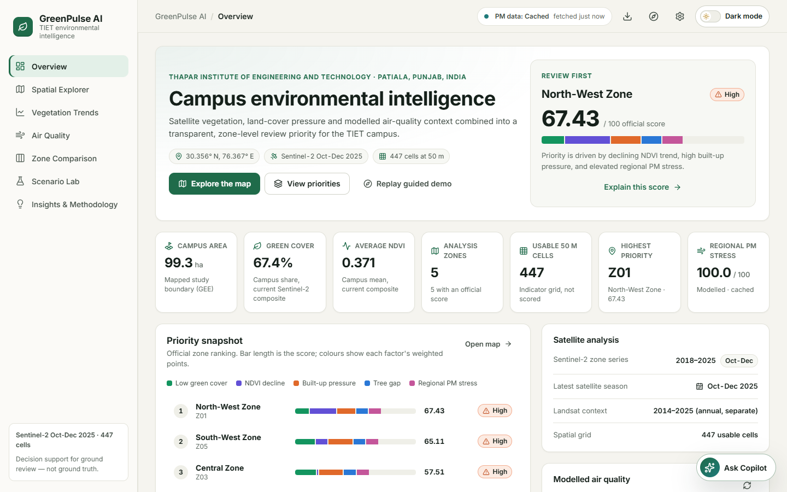
</p>

<table>
  <tr>
    <td width="50%">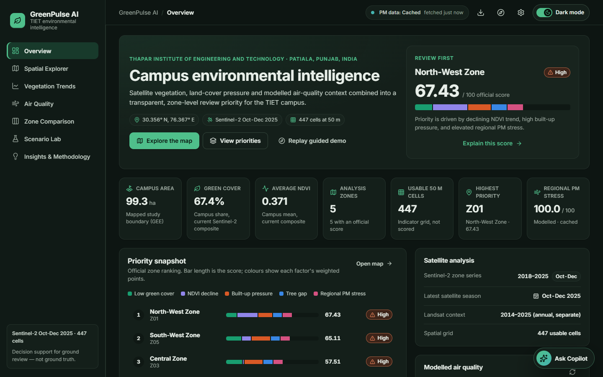<br/><sub><b>Overview · dark mode</b></sub></td>
    <td width="50%">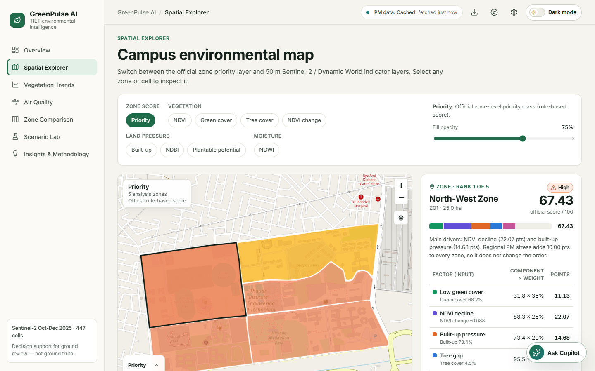<br/><sub><b>Spatial Explorer · official priority layer and score breakdown</b></sub></td>
  </tr>
  <tr>
    <td>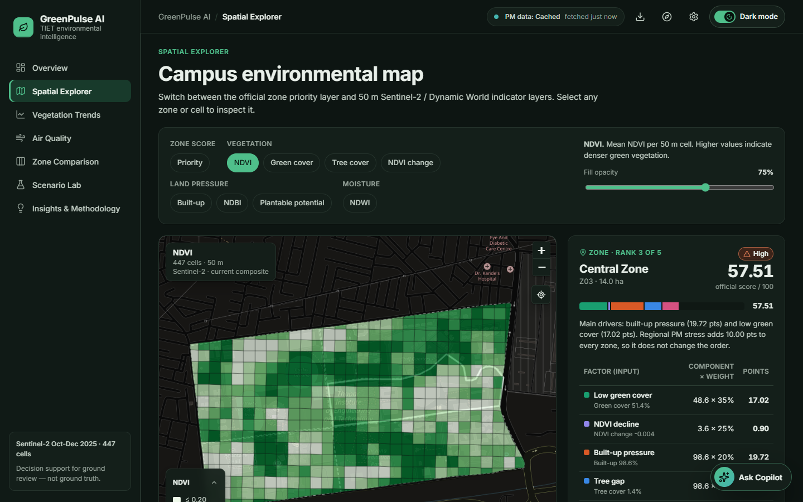<br/><sub><b>Spatial Explorer · 447 cells, NDVI layer, dark mode</b></sub></td>
    <td>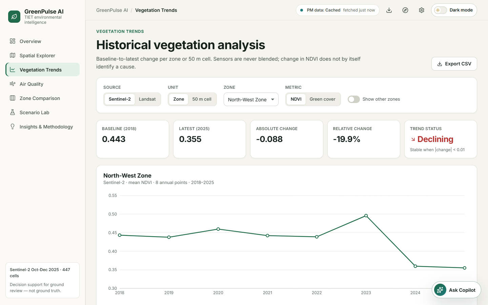<br/><sub><b>Vegetation Trends · Sentinel-2 2018–2025</b></sub></td>
  </tr>
  <tr>
    <td>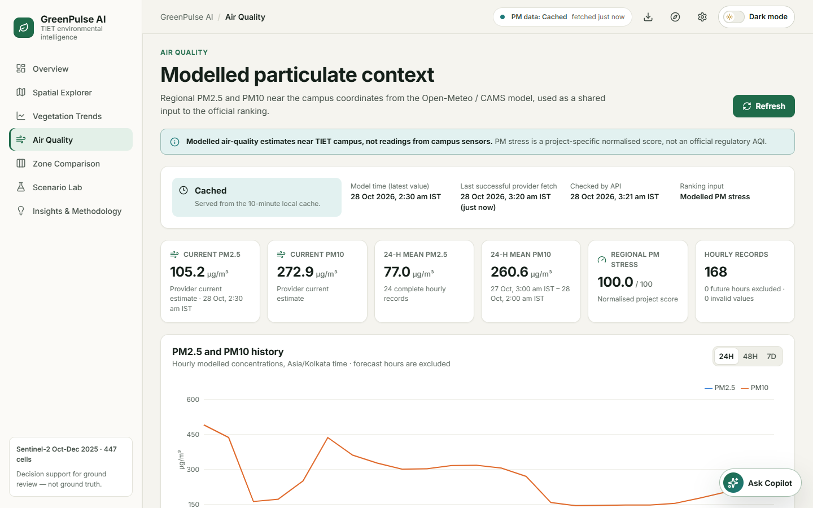<br/><sub><b>Air Quality · modelled PM with honest freshness</b></sub></td>
    <td>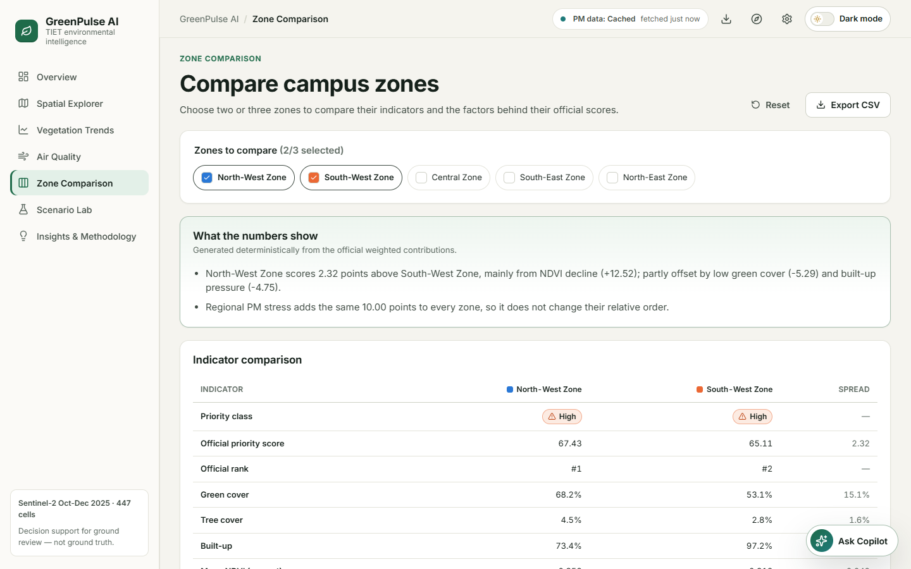<br/><sub><b>Zone Comparison</b></sub></td>
  </tr>
  <tr>
    <td>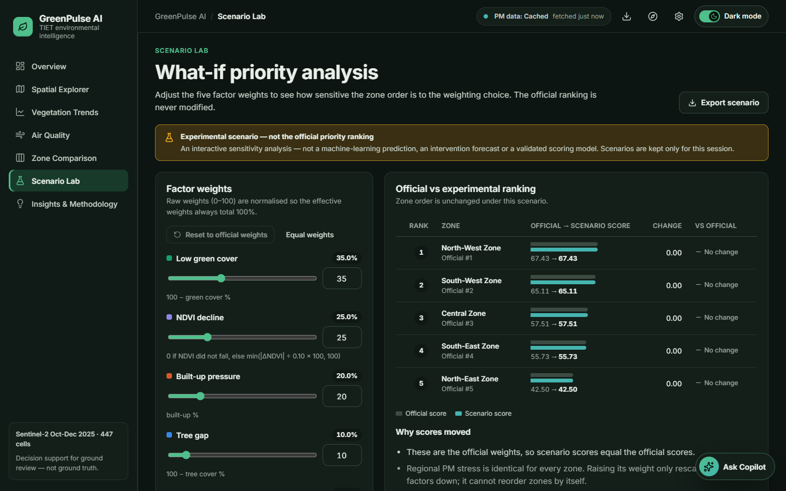<br/><sub><b>Scenario Lab · experimental weights, dark mode</b></sub></td>
    <td>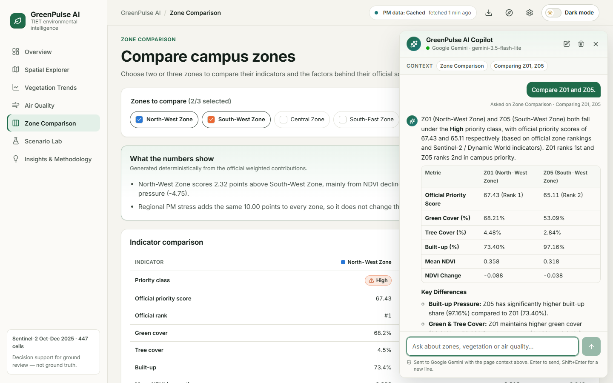<br/><sub><b>AI Copilot · "Compare Z01 and Z05." (real Gemini answer)</b></sub></td>
  </tr>
  <tr>
    <td colspan="2">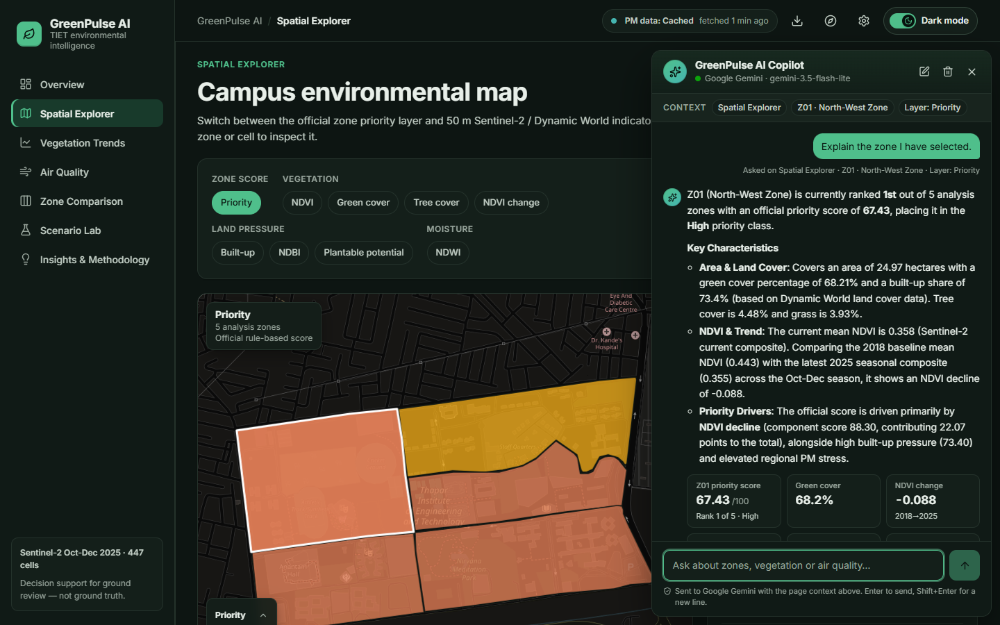<br/><sub><b>AI Copilot · context-aware ("Explain the zone I have selected."), key figures from server data, dark mode</b></sub></td>
  </tr>
</table>

---

## 🌱 Overview

GreenPulse AI answers five practical questions for campus planners:

| # | Question | Signal used |
|:-:|---|---|
| 1 | Which zones have weaker vegetation? | Sentinel-2 NDVI, green-cover % |
| 2 | Which zones are losing vegetation over time? | Sentinel-2 NDVI change, 2018 → 2025 (Oct–Dec composites) |
| 3 | Which zones are under built-up pressure? | Dynamic World land cover |
| 4 | What is the recent PM2.5 / PM10 stress near campus? | Open-Meteo / CAMS modelled air quality |
| 5 | **Which zones should be reviewed first, and why?** | Weighted, explainable zone priority score |

The campus was outlined in Google Earth Engine and split into **5 analysis zones** and **447 usable 50 m × 50 m cells**. Every official score shows its inputs, component scores, weights and weighted contributions.

> [!NOTE]
> This is an honest MVP: **no machine-learning model, campus sensor, drone workflow or plant-species module is implemented.** Those are listed under [Roadmap](#-roadmap). The official score is rule-based. Guided Insights is a fixed, rule-based assistant; the optional [AI Copilot](#-ai-copilot-gemini) uses Google Gemini only to explain figures that read-only server tools return.

---

## ✨ Features

| Area | What you can do |
|---|---|
| **Overview** | Key indicators from the loaded data (area, green cover, NDVI, zones, cells, top zone, regional PM stress), a priority snapshot with stacked score contributions, satellite and air-quality data status, and quick insights. |
| **Spatial Explorer** | Leaflet map of the 5 zones and 447 cells with 9 layers — Priority, NDVI, Green cover, Tree cover, NDVI change, Built-up, NDBI, Plantable potential, NDWI. Legends with units and a "No data" class, fill-opacity control, fit-to-campus button, zone outlines over cell layers, safe text tooltips, and a details panel with a full score breakdown (zones) or cell-level indicators (cells). |
| **Vegetation Trends** | Sentinel-2 zone or 50 m cell series and a separate Landsat context series; NDVI or green cover; baseline vs latest, absolute and relative change, improving/declining/stable status with the threshold shown; other zones as grey context lines; CSV export. |
| **Air Quality** | Current and 24-hour mean PM2.5/PM10, PM stress with the worked calculation, 24H/48H/7D history, manual refresh, model time vs last provider fetch, cache status (fresh / cached / stale / unavailable), provider-error and offline states. |
| **Zone Comparison** | Compare 2–3 zones: indicator table with spreads, grouped land-cover bars, contribution stacks, Sentinel-2 NDVI history, a deterministic interpretation, reset and CSV export. |
| **Scenario Lab** | Experimental sensitivity analysis: adjust the five weights (normalised to 100%), compare official vs scenario scores and ranks, see which factor moved each zone, reset to official weights, export. Never changes the official ranking. |
| **Insights & Methodology** | Traceable insights (each lists its source fields/files), the rule-based Guided Insights assistant (fixed questions; out-of-scope questions such as species choice or air-quality forecasts get an explicit "Not answered"), the full scoring method, data sources, interpretation limits, future scope, and exports. |
| **AI Copilot** | Floating "Ask Copilot" button and chat panel (Google Gemini). Knows the current page, selected zone or cell, map layer, trend settings, compared zones and experimental scenario weights; answers through ten read-only data tools; shows the real tool progress, source chips, key figures and tables built from server data, flags figures it could not match to the evidence, shows which model answered, and suggests follow-ups. Stop, retry, new chat and clear chat; can be switched off in Settings. |
| **MCP server** | The same ten read-only tools exposed over the Model Context Protocol (stdio), for Claude Desktop, Claude Code, MCP Inspector or any MCP-compatible agent. |
| **Exports & report** | Priority ranking CSV, comparison/trend/scenario CSVs, analysis snapshot JSON, and a print-friendly report page. CSVs carry source, unit and date metadata and are protected against spreadsheet formula injection. |
| **Theme & settings** | Light / Dark / System theme with a one-click header switch, applied before first paint and persisted locally; reduced-motion, background-refresh, map scroll-zoom and AI Copilot preferences; reset. |
| **Guided demo** | An optional five-step, non-blocking tour (Next / Back / Skip / Finish). It never starts by itself; once finished, the overview offers "Replay guided demo", and focus returns to where it was. |

---

## 🛠️ Tech stack

| Layer | Technology |
|---|---|
| Frontend | React 18, Vite 6, plain CSS with design tokens, Inter (self-hosted via `@fontsource-variable/inter`) |
| Maps | Leaflet, React Leaflet (OpenStreetMap tiles; darkened with a CSS filter in dark mode) |
| Charts | Recharts |
| Motion & icons | CSS transitions and keyframes (switched off under reduced motion), Lucide |
| Backend | FastAPI, Uvicorn, pandas, NumPy, Requests |
| Earth observation | Google Earth Engine exports (Sentinel-2, Landsat, Dynamic World) |
| Air quality | Open-Meteo Air Quality API (CAMS) |
| AI Copilot | Google Gemini through the official `google-genai` SDK (backend only, native function calling run by the server), `python-dotenv` |
| MCP | Official Python MCP SDK (`mcp`), stdio transport |
| Tests | pytest + FastAPI TestClient + MCP client; Vitest + Testing Library; Playwright + axe-core |

---

## 🏗️ Architecture

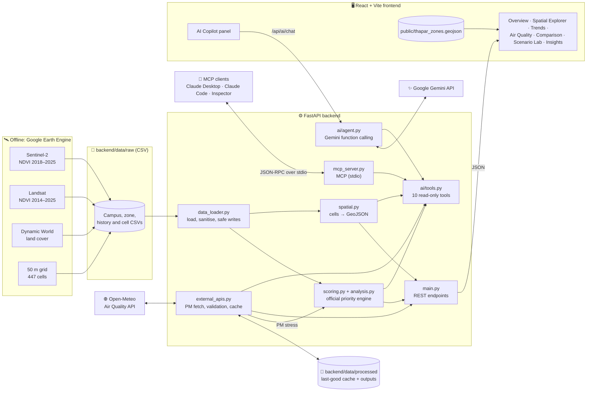

### Refresh consistency

PM stress is an input to the official score, so the dashboard never updates one without the other:

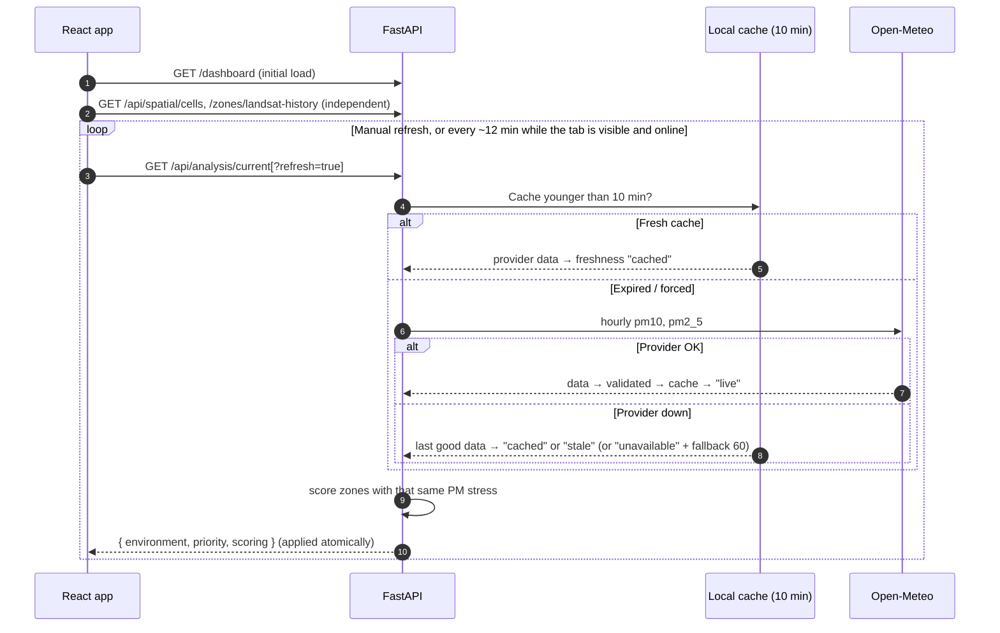

The frontend shares one in-flight refresh between callers, ignores responses older than the data already displayed, aborts requests on unmount, keeps the last good data visible when a refresh fails, and pauses background refresh when the tab is hidden or offline.

### Project structure

```text
GreenPulse-AI/
├── backend/
│   ├── app/                 # main, config, data_loader, scoring, analysis, spatial, external_apis, schemas
│   │   ├── ai/              # Copilot: settings, provider, tools, context, prompts, agent, verify, runs, routes
│   │   └── mcp_server.py    # MCP server over the same tool registry
│   ├── mcp_server.py        # MCP launcher usable from any working directory
│   ├── .env.example         # Copilot settings template (copy to .env, which is git-ignored)
│   ├── data/raw/            # Earth Engine and OpenAQ CSV exports (committed)
│   ├── data/processed/      # Runtime outputs and cache (git-ignored)
│   ├── tests/               # pytest suite (no live network or Gemini calls)
│   ├── requirements.txt
│   └── requirements-dev.txt
├── frontend/
│   ├── public/              # thapar_zones.geojson, favicon
│   ├── src/
│   │   ├── App.jsx          # routing, selection, comparison/scenario state
│   │   ├── api.js           # API client with timeouts and abort
│   │   ├── context/         # theme, preferences and the Copilot conversation
│   │   ├── hooks/           # data loading/refresh, hash routing, focus trap
│   │   ├── lib/             # formatting, scoring helpers, insights, assistant, Copilot context, safe Markdown, CSV
│   │   ├── components/      # views, the Copilot launcher/panel and shared UI
│   │   └── styles/          # tokens.css (design tokens), app.css, copilot.css
│   ├── e2e/                 # Playwright workflow, Copilot and accessibility tests
│   └── package.json
├── docs/                    # Project context, upgrade report and screenshots/
└── README.md
```

---

## 🤖 AI Copilot (Gemini)

The Copilot explains the evidence the application already holds. It uses **native Gemini function calling**: Gemini decides which **read-only tool** is relevant, only the backend runs tools (using the same services as the dashboard), and their results go back to Gemini as data. The Copilot does not go through MCP.

```mermaid
sequenceDiagram
    autonumber
    actor U as User
    participant UI as Copilot panel (React)
    participant API as FastAPI /api/ai/chat
    participant G as Google Gemini<br/>(primary, optional fallback)
    participant T as Tool registry (ai/tools.py)
    participant S as GreenPulse services

    U->>UI: Question
    UI->>API: question + recent turns + page context (IDs and settings only)
    API->>API: validate context against the datasets; server-owned instructions
    loop At most 4 tool calls
        API->>G: conversation + 10 tool declarations
        G-->>API: function_call(name, args)
        API->>T: validate args (Pydantic), allowlisted tools only
        T->>S: official scoring · cached air quality · spatial cells · allowlisted docs
        S-->>T: data
        T-->>API: payload + evidence + key figures + table/series
        API->>G: function_response(payload)
    end
    G-->>API: final answer
    API->>API: check every figure against the tool results; strip links and HTML
    API-->>UI: answer, sources, key figures, table/sparkline, model used, follow-ups
    Note over UI,API: While waiting, the panel polls GET /api/ai/chat/{id}/progress<br/>("Asking Gemini", the tool actually running, "Generating answer")
```

### Tool registry (shared by the Copilot and the MCP server)

| Tool | Arguments | Returns |
|---|---|---|
| `get_campus_overview` | — | Area, green cover, average NDVI, vegetation classes, zones, 50 m cells |
| `get_zone_rankings` | — | The official ranking (same scoring snapshot as the dashboard) |
| `get_zone_details` | `zone_id` | One zone's indicators, NDVI trend and score components |
| `compare_zones` | `zone_ids` (2–3) | Zones side by side, with differences and the factors behind the score gap |
| `get_vegetation_history` | `dataset` (sentinel2 / landsat), `unit`, `zone_id` or `cell_id` | Sentinel-2 **or** Landsat history (never merged) |
| `get_air_quality_context` | — | Modelled PM2.5/PM10, 24-hour means and window, PM stress, freshness |
| `get_spatial_cell_details` | `cell_id` | One cell's indicators and parent zone (no cell-level score) |
| `get_scoring_methodology` | — | Formula, weights, class thresholds, limitations |
| `get_scenario_comparison` | five weights (0–100) | Hypothetical re-weighting of the official components (labelled experimental) |
| `get_project_methodology` | `query` | Keyword search over allowlisted sections of this README and `docs/` |

Every tool is read-only, has a strict Pydantic argument model, a bounded response and a list of source references (`evidence`). There is no shell, SQL, URL or file-path access.

- **Grounding:** the server writes the system instructions (the client cannot send one). Gemini must fetch values with tools, keep Sentinel-2 and Landsat apart, keep scenario results separate from official ones, and refuse claims the project cannot support (campus sensors, AQI forecasts, ML, drone validation, planting suitability, causation). Key figures, tables and the trend sparkline in the panel are built from tool results, not model text. Numbers in the answer that cannot be matched to the evidence are listed under the answer.
- **Context:** page, selected zone or cell, map layer, trend dataset/unit/metric, compared zones, air-quality range, and Scenario Lab weights (shared on the Scenario Lab, or elsewhere once changed). The backend validates every ID; client numbers never replace server calculations. Each question shows the context it was asked with.
- **Safety:** answers are rendered as text-only Markdown (no HTML, no links). Requests are size-limited (64 kB, 2,000-character questions), throttled per client (12 per minute, 2 at a time), bounded in history and time, and cancelled on the server when you press Stop or leave.
- **Privacy:** questions, recent turns and a short page description go to Google Gemini. The key stays on the server. Conversations live only in the tab's memory. Turning the Copilot off in Settings hides it, stops any running answer, and sends nothing further.
- **Models:** the primary (`GEMINI_MODEL`) answers by default. If it is out of quota, rate-limited, unavailable, overloaded or too slow, the optional `GEMINI_FALLBACK_MODEL` is tried once, reusing any data tools already run; key and request errors never switch models. A model that returned 429, 404 or 503 is paused for a while (Google's retry delay, capped at an hour) so it is not called repeatedly. Every answer records the model that produced it; the panel header, the answer footer ("Answered by …, fallback because …") and Settings show it. 429 errors show Google's quota detail (limit, model, quota type).

---

## 🔌 MCP server

`backend/app/mcp_server.py` is an actual [Model Context Protocol](https://modelcontextprotocol.io) server built with the official Python MCP SDK. It exposes the **same tool registry** as the Copilot (same names, descriptions, JSON schemas, argument validation and handlers), so there is one implementation of every tool and no duplicated business logic.

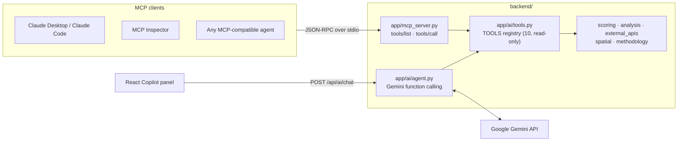

| | Native Gemini function calling | MCP server |
|---|---|---|
| Used by | The in-app AI Copilot | External MCP clients (Claude Desktop, Claude Code, MCP Inspector, agents) |
| Code | `app/ai/agent.py`, `app/ai/routes.py` | `app/mcp_server.py` |
| Transport | HTTPS between FastAPI and the Gemini API | JSON-RPC over stdio |
| Who decides which tool | Gemini; the backend validates and runs it | The MCP client's model; the server validates and runs it |
| Tools | `app/ai/tools.py` (shared) | `app/ai/tools.py` (shared) |
| Needs a Gemini key | Yes | No |

Each MCP tool is annotated `readOnlyHint: true, destructiveHint: false, idempotentHint: true`. A successful call returns `{tool, data, evidence}` as both text and structured content; invalid arguments, unknown zones or cells and unknown tools return an MCP tool error (`isError: true`) with a readable message, never a traceback.

**Run it** (from `backend/`):

```powershell
.\.venv\Scripts\python.exe -m app.mcp_server        # macOS/Linux: .venv/bin/python -m app.mcp_server
```

**Claude Desktop / Claude Code configuration** (use absolute paths):

```json
{
  "mcpServers": {
    "greenpulse-ai": {
      "command": "C:/path/to/GreenPulse-AI/backend/.venv/Scripts/python.exe",
      "args": ["C:/path/to/GreenPulse-AI/backend/mcp_server.py"]
    }
  }
}
```

With Claude Code you can also run `claude mcp add greenpulse-ai -- <python> <path>/backend/mcp_server.py`. To explore the tools interactively: `npx @modelcontextprotocol/inspector <python> <path>/backend/mcp_server.py`.

---

## 🚀 Getting started

### Prerequisites

- **Python 3.10 or newer** (tested with 3.12). The code uses `X | None` type hints, so Python 3.9 cannot import it.
- **Node.js 20+** and npm (tested with Node 24.3).
- Optional: a **Google Gemini API key** from [Google AI Studio](https://aistudio.google.com/apikey) for the AI Copilot.

### 1. Backend (terminal 1)

```powershell
cd backend
py -3.12 -m venv .venv                      # or: python3 -m venv .venv
.\.venv\Scripts\python.exe -m pip install -r requirements.txt
.\.venv\Scripts\python.exe -m uvicorn app.main:app --host 127.0.0.1 --port 8000
```

On macOS/Linux use `.venv/bin/python` instead of `.\.venv\Scripts\python.exe`. While editing backend code, add `--reload --reload-dir app` (run it in an interactive terminal; see [Troubleshooting](#-troubleshooting)).

### 2. Frontend (terminal 2)

```powershell
cd frontend
npm ci
npm run dev                                 # serves http://127.0.0.1:5173 (see vite.config.js)
```

### 3. Gemini AI Copilot (optional)

```powershell
cd backend
Copy-Item .env.example .env                 # macOS/Linux: cp .env.example .env
# edit .env: set GEMINI_API_KEY (and optionally GEMINI_MODEL / GEMINI_FALLBACK_MODEL)
```

`backend/.env` is git-ignored and re-read automatically when it changes. Open **Settings → AI Copilot → Check connection** to verify the key and both models with free model lookups (nothing is generated). Without a key the dashboard works normally and the Copilot explains that its configuration needs attention.

### 4. MCP server (optional)

No extra setup: it uses the backend virtual environment and data. See [MCP server](#-mcp-server) for the command and client configuration.

### 5. Open

| Service | URL |
|---|---|
| Dashboard | http://127.0.0.1:5173 |
| API | http://127.0.0.1:8000 |
| Interactive API docs | http://127.0.0.1:8000/docs |

### Configuration

| Variable | Where | Default | Purpose |
|---|---|---|---|
| `VITE_API_BASE_URL` | frontend | `http://127.0.0.1:8000` | API location |
| `GREENPULSE_CORS_ORIGINS` | backend | `http://localhost:5173,http://127.0.0.1:5173,http://localhost:4173,http://127.0.0.1:4173` | Comma-separated allowed browser origins |
| `GREENPULSE_OPEN_METEO_URL` | backend | Open-Meteo endpoint | Point at an unreachable URL to demonstrate offline behaviour |
| `GEMINI_API_KEY` | `backend/.env` | empty | Gemini API key for the AI Copilot. Never put it in the frontend. |
| `GEMINI_MODEL` | `backend/.env` | `gemini-3.5-flash-lite` | Primary Gemini model |
| `GEMINI_FALLBACK_MODEL` | `backend/.env` | empty (none) | Optional second model (e.g. `gemini-3.1-flash-lite`), tried once when the primary is out of quota, rate-limited, unavailable, overloaded or too slow |
| `AI_ASSISTANT_ENABLED` | `backend/.env` | `true` | `false` hides the Copilot and refuses chat requests |
| `AI_MAX_TOOL_CALLS` | `backend/.env` | `4` | Data tool calls per question (0–4) |
| `AI_MAX_HISTORY_MESSAGES` | `backend/.env` | `12` | Earlier messages sent with a question (0–20) |
| `AI_TIMEOUT_SECONDS` | `backend/.env` | `30` | Time limit for one answer (5–120) |

See [`backend/.env.example`](backend/.env.example) for a commented template with placeholders. Process environment variables override the file.

### Deep links

Views use hash routes, so browser back/forward works: `#/overview`, `#/map`, `#/trends`, `#/air-quality`, `#/compare`, `#/scenario`, `#/insights`, `#/report`. The map keeps its state in the URL, e.g. `#/map?layer=ndvi&zone=Z03`. The older `?layer=ndvi` link still opens the map on that layer.

---

## 🧮 Priority scoring

Each zone gets a transparent score from **0 to 100**, calculated per zone by the backend (`backend/app/scoring.py`).

| Factor | Component score (0–100) | Weight |
|---|---|:-:|
| Low green cover | `100 − green_cover_percent` | **35%** |
| NDVI decline | `0` if ΔNDVI ≥ 0, else `min(|ΔNDVI| ÷ 0.10 × 100, 100)` | **25%** |
| Built-up pressure | `built_up_percent` | **20%** |
| Tree gap | `100 − tree_percent` | **10%** |
| Regional PM stress | `0.6 × PM2.5 score + 0.4 × PM10 score` | **10%** |

```text
ΔNDVI        = latest-year mean NDVI − baseline-year mean NDVI   (Sentinel-2, same Oct–Dec season, 2018 → 2025)
PM2.5 score  = min(mean PM2.5 of the latest 24 complete hourly records / 60 × 100, 100)
PM10 score   = min(mean PM10 of the latest 24 complete hourly records / 100 × 100, 100)
PM stress    = 0.6 × PM2.5 score + 0.4 × PM10 score        (documented fallback 60 if no usable PM data)
Priority     = 0.35·LowGreen + 0.25·NDVIDecline + 0.20·BuiltUp + 0.10·TreeGap + 0.10·PMStress
```

- **Classes:** ≤ 30 Low · ≤ 50 Moderate · ≤ 70 High · > 70 Urgent (upper bounds inclusive).
- **PM averaging** uses only hours at or before the current hour; forecast hours, negative or non-numeric concentrations are excluded. A record counts only if it has both PM2.5 and PM10. `averages_24h.complete` is true only when those 24 records are 24 consecutive hours; gaps are reported through `span_hours` rather than hidden.
- **Cached data** is re-evaluated against its own fetch time, so an hour that was a forecast when it was fetched never becomes "history" later.
- **Missing inputs** are never scored as zero: a zone with missing or invalid required inputs is returned with `score_status: "insufficient_data"`, no score, class "Unavailable" and a list of `missing_inputs`.
- **Duplicate zone IDs** make the dataset invalid (HTTP 503 with an explanation).
- **Ties** in the official ranking are ordered by zone ID so results are deterministic. The Scenario Lab instead gives equal scenario scores a shared rank, so a tie never shows up as a rank change.
- **Shared PM stress:** the same regional value is added to every zone, so it shifts all totals equally and cannot change their relative order.
- The 60 and 100 µg/m³ values are project normalisation caps, **not** regulatory limits, and PM stress is **not** an official AQI.

Each zone's reason is generated from these triggers: green cover < 60%, NDVI change < −0.05, built-up > 70%, PM stress > 60.

With the documented PM fallback of 60 the reference ranking is **Z01 63.43 · Z05 61.11 · Z03 53.51 · Z04 51.73 · Z02 38.50** (frozen in a regression test). With live modelled PM the shared term shifts every zone equally.

---

## 📂 Datasets

| File (in `backend/data/raw/`) | Source | Status |
|---|---|:-:|
| `thapar_campus_summary.csv` | Earth Engine | Required |
| `thapar_zone_ndvi_green_cover.csv` | Sentinel-2 | Required |
| `thapar_zone_land_cover.csv` | Dynamic World | Required |
| `thapar_historical_zone_ndvi_2018_2025.csv` | Sentinel-2 (Oct–Dec) | Required |
| `thapar_50m_master_current_2025.csv` | Earth Engine, 50 m grid | Optional |
| `thapar_50m_historical_ndvi_2018_2025.csv` | Sentinel-2, 50 m grid | Optional |
| `thapar_landsat_historical_zone_ndvi_2014_2025.csv` | Landsat annual composites | Optional |
| `openaq_location_5544_measurments.csv` | OpenAQ station export (reference only; not used in scoring) | Optional |
| `frontend/public/thapar_zones.geojson` | Earth Engine zone polygons | Optional |

Generated at runtime in `backend/data/processed/` (git-ignored): `zone_environmental_priority.csv`, `open_meteo_recent_hourly.csv`, `open_meteo_last_good.json`, `dashboard_summary.json`. The original datasets are never modified.

---

## 📡 API reference

| Method | Endpoint | Description |
|:-:|---|---|
| `GET` | `/` | Service status |
| `GET` | `/health` | Health check with dataset availability |
| `GET` | `/summary` | Campus summary |
| `GET` | `/zones/ndvi`, `/zones/land-cover`, `/zones/historical-ndvi` | Raw zone datasets |
| `GET` | `/zones/landsat-history` | Optional Landsat context with year metadata |
| `GET` | `/priority` | Official ranked zone table (uses the same PM payload as `/api/environment/current`) |
| `GET` | `/dashboard` | Everything the UI needs initially, including `scoring` and dataset metadata |
| `GET` | `/api/analysis/current?refresh=` | Modelled PM context **and** the ranking scored from it, in one response |
| `GET` | `/api/environment/current?refresh=` | Modelled PM: current, 24-hour means, stress, hourly records |
| `GET` | `/api/environment/air-quality/history?hours=24..168` | Hourly PM history |
| `GET` | `/aqi/open-meteo/recent?start_date=&end_date=` | Legacy explicit date range (validated, ≤ 31 days) |
| `GET` | `/api/spatial/cells` | 50 m cells as GeoJSON (invalid geometry skipped and counted) |
| `GET` | `/api/spatial/cells/history?cell_id=…` or `?zone_id=…` | Cell NDVI history (one parameter required) |
| `GET` | `/api/ai/status?verify=` | Copilot availability, primary and fallback models, cooldowns, last model used, key configured (boolean only); `verify=true` checks both models with free model lookups |
| `POST` | `/api/ai/chat` | Ask the Copilot: `{request_id?, message, history[], context{}}` → answer, evidence, facts, visual, follow-ups, verification, model used |
| `GET` | `/api/ai/chat/{request_id}/progress` | Real progress of a running answer |
| `POST` | `/api/ai/chat/{request_id}/cancel` | Stop a running answer |

**Air-quality freshness** (`freshness` field): `live` = fetched from the provider during this request; `cached` = served from the local cache fetched less than 10 minutes ago; `stale` = the provider failed and an older last-good response is shown; `unavailable` = no usable data (ranking uses fallback 60). Responses also include `fetched_at` (when the provider was queried), `cache_age_seconds` (null if the cache is dated in the future), `last_updated` (model time of the latest value, Asia/Kolkata), `pm_stress_source` (`modelled` / `fallback`), `averages_24h` with its window and `span_hours`, `data_quality` counters and `provider_status`. Naive timestamps are Asia/Kolkata (UTC+05:30). The backend always fetches 168 past hours so every endpoint shares one complete cache; after a provider failure it waits 60 seconds before querying again (requests in between get the last good data with the failure reason). A response without a single complete PM2.5/PM10 hour never replaces the last good cache. The legacy date-range endpoint returns every hour of the requested range.

`aqi_stress_score` in priority rows is kept as a deprecated alias of `pm_stress_score`.

---

## 🧪 Testing

```powershell
# Backend: pytest (mocked Open-Meteo and Gemini; real MCP client) — no internet needed
cd backend
.\.venv\Scripts\python.exe -m pip install -r requirements-dev.txt
.\.venv\Scripts\python.exe -m pytest

# Frontend unit and component tests (Vitest + Testing Library), lint and build
cd frontend
npm run test
npm run lint
npm run build

# End-to-end and accessibility (Playwright + axe-core)
# Starts the backend and Vite automatically if they are not already running.
npm run test:e2e
```

Playwright uses the locally installed Google Chrome (`channel: "chrome"`). To use Playwright's bundled Chromium instead, run `npx playwright install chromium` and set `PLAYWRIGHT_CHANNEL=chromium`. The E2E suite writes review screenshots to `review-screenshots/` (git-ignored).

### Latest results (28 Oct 2026)

| Suite | Result |
|---|---|
| Backend pytest (scoring, air-quality cache, API, Copilot agent with scripted Gemini responses, MCP server) | **172 passed** |
| Frontend Vitest (components, Copilot panel, safe Markdown, scenario maths, CSV, hooks) | **124 passed** |
| ESLint · production build | 0 problems · succeeded |
| Playwright (workflow smoke 11, Copilot 5, axe WCAG A/AA 3) | **19 passed**, 0 accessibility violations in light and dark themes |
| MCP, real client over stdio | 10 tools discovered; `get_zone_rankings`, `compare_zones`, `get_air_quality_context` returned live project data; an unknown zone returned a tool error |
| Gemini, real requests | "Compare Z01 and Z05." answered by `gemini-3.5-flash-lite` through the `compare_zones` tool, all 20 figures matched the evidence; fallback switching verified against the real API |

Copilot tests never call Gemini: the backend suite replays scripted Gemini responses (real `google-genai` response objects) through the tool loop, and the browser suite (`e2e/copilot.spec.js`) mocks only the Copilot endpoints while the real backend serves all data. MCP tests use the official MCP client, both in-process and by launching `backend/mcp_server.py` as a stdio subprocess. A live Gemini check is a manual step: ask a question in the panel, or use **Settings → AI Copilot → Check connection**.

The backend suite includes a regression test that compares the official scores with a frozen copy of the original formula, and asserts the documented reference ranking with the PM fallback of 60: Z01 63.43, Z05 61.11, Z03 53.51, Z04 51.73, Z02 38.50.

---

## ⚠️ Limitations

> [!IMPORTANT]
> GreenPulse AI is decision support. Its outputs indicate where to look first; they are not ground truth.

- NDVI thresholds (green-cover share) are **project-calibrated**, not universal ecological classes.
- **Dynamic World** is a supporting ~10 m indicator, not building-level ground truth.
- Satellite data have **finite spatial resolution**; small features mix within pixels and 50 m cells.
- **Sentinel-2** (seasonal Oct–Dec) and **Landsat** (annual) are different sensors and are shown separately, never merged.
- **PM values are regional modelled estimates** near one coordinate, not campus or zone measurements.
- The **official score is zone-level**; 50 m cells show indicators only.
- A cell with **mapped plantable potential is not a validated planting site**; any intervention needs local ground review.
- **No causal link** between vegetation change and air quality is claimed.
- The **AI Copilot** is a language model: it can still phrase things imperfectly. Its figures come from tools and are checked, but its interpretation is not reviewed; rely on the dashboard views for decisions. It needs internet access and a Gemini key, depends on Google's availability and quota, and its API is unauthenticated, so do not expose the backend publicly without adding authentication.
- The **MCP server** runs locally over stdio with the permissions of the user who starts it; it is read-only but has no authentication of its own.

---

## 🧰 Troubleshooting

| Symptom | Fix |
|---|---|
| `TypeError: unsupported operand type(s) for \|` when starting the backend | You are on Python 3.9. Create the venv with Python 3.10+ (`py -3.12 -m venv .venv`). |
| Dashboard shows "Could not reach the GreenPulse API" | Start the backend on port 8000, or set `VITE_API_BASE_URL`. |
| Browser console shows a CORS error | Serve the frontend from an allowed origin or add it to `GREENPULSE_CORS_ORIGINS`. |
| Air quality shows "Stale" or "Unavailable" | Open-Meteo is unreachable; the last good data or the documented fallback is used. Use Refresh when the network returns. |
| Map area is grey | OpenStreetMap tiles need internet access; the GeoJSON layers still render. |
| Copilot says "Your Gemini API configuration needs attention" | Add `GEMINI_API_KEY` to `backend/.env` (or fix the key or model name). Settings → AI Copilot shows the exact state. |
| Copilot says "Gemini is temporarily unavailable" or "took too long" | Google returned 503 (high demand) or 504, or the model did not answer within `AI_TIMEOUT_SECONDS`. Try again later, or set a `GEMINI_FALLBACK_MODEL`. |
| Copilot says the quota is used up (HTTP 429) | The error shows Google's quota detail, e.g. "Daily free-tier request limit of 20 for … reached". Quotas are per project and per model: wait for the reset (daily limits reset at midnight Pacific time), use a key from a project with a higher tier, or configure a fallback model. The backend pauses a model after a 429 (up to an hour, or Google's retry delay) instead of calling it again. |
| No Copilot button | It is switched off in Settings, or `AI_ASSISTANT_ENABLED=false` on the server. |
| MCP client shows no tools or "server disconnected" | Use absolute paths to the backend virtual-environment Python and `backend/mcp_server.py`; run it once in a terminal to see errors (it waits silently for a client on stdin when healthy). |
| `npm run test:e2e` cannot find Chrome | Install Chrome, or run `npx playwright install chromium` and set `PLAYWRIGHT_CHANNEL=chromium`. |
| Backend keeps serving old code, or exits, after a file change with `--reload` | On Windows, uvicorn's reloader restarts its worker with a console Ctrl+C event. In this project's testing that was unreliable when the server was started as a detached/background process (a minimal FastAPI app behaved the same). Behaviour can differ between terminals; if reload misbehaves, run without `--reload` and restart the server after edits. Check which process owns the port with `Get-NetTCPConnection -LocalPort 8000` before assuming the code is current. |
| `http://127.0.0.1:5173` refuses connections after `npm run dev -- --host …` in PowerShell | When npm runs through its PowerShell shim, the `--` can be consumed, so Vite never sees the flags. Use plain `npm run dev` (host and port are set in `vite.config.js`), or `npx vite --port 5174` to change the port. |
| Port 5173 or 8000 is busy | Stop the other process, or run `npx vite --port 5174` / uvicorn with `--port 8001` (then update `VITE_API_BASE_URL` and `GREENPULSE_CORS_ORIGINS`). |

---

## 🗺️ Roadmap

- [x] CSV-first FastAPI backend with explainable, deterministic scoring
- [x] Spatial explorer with 50 m grid (447 cells) and 9 map layers
- [x] Modelled PM context with honest freshness and last-good caching
- [x] Zone comparison, Scenario Lab (sensitivity analysis), rule-based Guided Insights, exports
- [x] Light/dark/system themes, accessibility checks, automated tests
- [x] Grounded Gemini AI Copilot with read-only tools, source references and model fallback
- [x] MCP server over the same tool registry
- [ ] Local PM sensor validation (ESP32 PM2.5 / PM10 node)
- [ ] Field, drone and phone-image validation workflows
- [ ] Reviewed cell-level intervention scoring
- [ ] Machine learning once labelled training data exists
- [ ] Plant-species recommendation
- [ ] PostGIS storage and GeoTIFF tile rendering
- [ ] Authenticated production deployment

---

## 👥 Project & attribution

- **Capstone project**, Thapar Institute of Engineering & Technology (TIET), Patiala, Punjab, India.
- **Original MVP** (Earth Engine exports, CSV-first FastAPI backend, first dashboard): [@Gupta2708](https://github.com/Gupta2708). Its commits are preserved in this repository's history.
- **Premium dashboard upgrade, Gemini AI Copilot and MCP server:** Vijayshree Vaibhav ([@vijayshreepathak](https://github.com/vijayshreepathak)).
- **Data and services:** Google Earth Engine with Copernicus Sentinel-2, USGS/NASA Landsat and Google Dynamic World; Open-Meteo Air Quality API (CAMS); OpenAQ; map tiles © OpenStreetMap contributors; Google Gemini API.

<p align="center">
  Built for a greener Thapar campus 🌍
</p>
